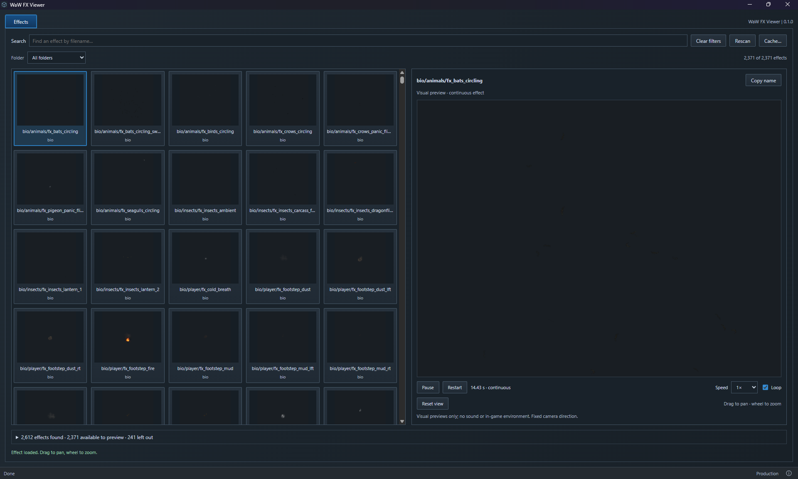

# WaW FX Viewer

**An unofficial community app. Not affiliated with Treyarch, Activision or UGX.**

Browse World at War's Modtools effects by eye, play a visual preview and copy the filename. Made by [phil81334](https://github.com/phil81334). Built with JavaScript, Rust, Vite and Tauri, with a native Direct3D 9 viewport.



## Download and run

1. Have World at War and its Modtools installed in the same game folder.
2. Open [Releases](https://github.com/phil81334/waw-fx-viewer/releases/latest). Under **Assets**, download **waw-fx-viewer.exe**. The source-code ZIP is for development.
3. Put the EXE beside `CoDWaW.exe`, then double-click it.

You do not need Node.js, Rust or VS Code to use the EXE. Windows needs [WebView2](https://developer.microsoft.com/microsoft-edge/webview2/#download-section), usually already installed; if missing, install its **Evergreen Bootstrapper**. The game does not need to be running.

## Browse effects

Search by filename or choose a folder, then click a thumbnail. **Copy name** copies the effect name. Play, pause, restart, change speed or repeat the preview with **Loop**. Drag to pan, wheel to zoom, or use **Reset view**. The app fits the camera automatically, trying another view or distance when needed. Some large effects use a labelled close-up that shows part of the effect. Authored sizes, timing and fade settings are kept.

Choose **Dark**, **Grey**, **Light** or **Checkerboard** separately for **Thumbnails** and the viewport's **Background**. Each control changes only its own area and keeps playback and your place in the catalogue. Light helps with dark particles; checkerboard makes distortion easier to see. Choices last until you close the app. Effects with lights can show a simple **Light receiver** plane.

The app reads your installed EFX definitions, materials, shaders, loose models and images in `main` IWD archives. It does not change game files.

**Catalogue information** shows how many effects were found and left out, with named reasons. Thumbnails load as you browse. Effects without a visible preview are hidden. A preview that works on another background returns when you change the thumbnail background. Effects with no output on any background are remembered until **Rescan**; left out does not mean broken. Some effects need source movement or scene geometry. Long tracers can remain tiny when their whole journey is in view.

Effects play for their authored lifetime, including any starting delay. **Loop** replays an effect when its particles and children finish; continuously emitting effects keep running. Sound, editing, exporting and the in-game world/environment are not included.

The catalogue and PNG thumbnails are cached in AppData. **Cache…** shows the location and size and lets you clear it. **Rescan** checks the installed files again, clears previews and retries excluded effects. The first scan and uncached previews take longer.

Errors are saved locally in `%LOCALAPPDATA%\com.phil81334.waw-fx-viewer\logs\viewer.log`.

## Run from source

**Windows setup — do this once.** Skip anything already installed.

| Install | What to choose |
| --- | --- |
| [VS Code](https://code.visualstudio.com/download) | The Windows installer. This is where you open the project. |
| [Node.js](https://nodejs.org/en/download) | **LTS**, **Windows**, **Installer (.msi)**. Keep the defaults; npm is included. |
| [Microsoft C++ Build Tools](https://visualstudio.microsoft.com/visual-cpp-build-tools/) | Select **Desktop development with C++**. Keep the selected MSVC tools and Windows SDK. |
| [Rust](https://rust-lang.org/tools/install/) | Run **rustup-init.exe (x64)** and choose the default installation. |

Close and reopen VS Code after installing these. [Tauri's Windows guide](https://v2.tauri.app/start/prerequisites/#windows) has more help. Vite and Tauri are installed by this project; no separate installation or Python is needed.

1. Choose **Code → Download ZIP** on GitHub, then extract it. You can clone the repo instead if you already use Git.
2. In VS Code, choose **File → Open Folder** and open the folder containing `package.json`.
3. Create a folder named `.local`, then a file inside it named `game-path.txt`.
4. Open your WaW folder in Windows File Explorer—the one containing `CoDWaW.exe`. Click the address bar, copy the full folder address, paste it into `game-path.txt` and save. Use your actual drive and folder. One line, no quotes, no EXE filename. Modtools must be installed there too.
5. Choose **Terminal → New Terminal** and run these one at a time:

   ```powershell
   npm install
   npm run dev
   ```

`npm install` downloads the project's dependencies. `npm run dev` opens the desktop app. The first run also downloads and compiles Rust dependencies, so give it time. Keep the terminal open; **Ctrl+C** stops development.

Next time, run `npm run dev`, or click the play button beside **dev** in VS Code's **NPM Scripts** panel. If hidden, right-click the Explorer panel headings and enable **NPM Scripts**. Update `game-path.txt` if you move WaW. The packaged EXE always uses its own folder instead.

| Command | What it does |
| --- | --- |
| `npm run dev` | Opens the desktop app for development. |
| `npm run dev:web` | Shows the UI in a browser. Cannot read effects or play native previews. |
| `npm run build` | Creates `release/waw-fx-viewer.exe`. |
| `npm run build:web` | Builds the UI files only. No EXE. |

To make your own EXE, run `npm run build`, then copy `release/waw-fx-viewer.exe` beside `CoDWaW.exe`.

[Credits](ATTRIBUTION.md) · [GPL-3.0 licence](LICENCE)
